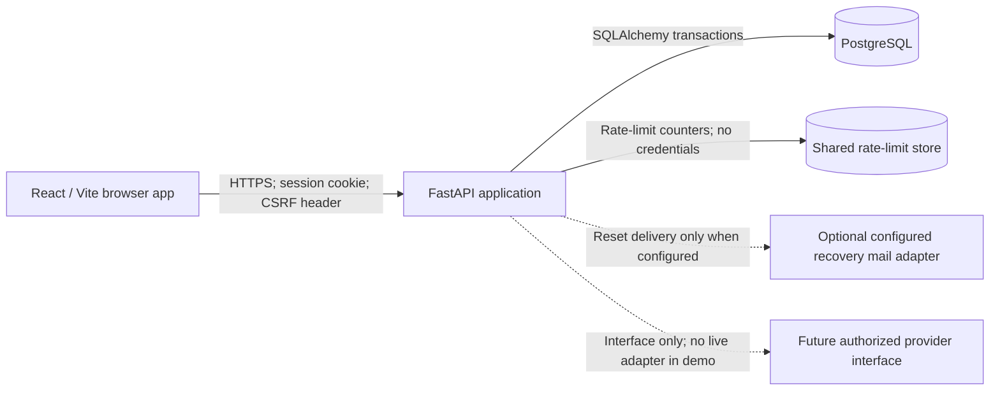

# SecurePay architecture

## System boundary

SecurePay is a single-user-facing web application for a controlled demonstration. The only value it handles is simulated demo money. No external financial institution, real payment network, analytics service, or identity provider is in scope.

## Components

### Browser application

- React, Vite, TypeScript, React Router, Lucide icons, and accessible reusable components.
- Calls the API; it is never authoritative for identity, roles, balances, fees, transaction status, or account ownership.
- Uses an opaque session cookie only for authentication. It does not put session identifiers or bearer tokens in localStorage or URLs.
- Keeps CSRF material in memory and sends it in a request header for unsafe methods. The API uses explicit CORS origins; production should serve the API and frontend same-site, preferably same-origin.
- Displays a persistent **DEMO** notice and states that receipts represent simulated transactions.

### FastAPI application

- Separates API routing, schemas, services/domain rules, repositories, persistence models, and middleware/configuration.
- Validates request sizes, field types, ranges, and allowed values with Pydantic and server-side domain checks.
- Resolves the acting user from the validated server-side session; never accepts a client-supplied sender identity or role.
- Applies ownership and role authorization at each protected operation.
- Implements password hashing, session lifecycle, CSRF validation, rate limiting, safe error responses, and security-relevant audit events.
- Keeps real payment integration behind an interface with no live implementation in the demonstration.

### Persistence

- SQLAlchemy and Alembic manage relational models and schema changes.
- PostgreSQL is the primary target for transfer isolation and row-level concurrency coordination.
- SQLite may be offered for local exploration, but tests for transfer races and PostgreSQL-specific integrity protections must run against PostgreSQL.
- Transfer updates, ledger entries, transaction state, and idempotency outcome are committed or rolled back as one unit.

### Optional services

- A shared rate-limit store is needed where multiple API workers must enforce a consistent limit. A per-process in-memory limiter is only suitable for isolated development.
- Password-reset delivery is disabled unless a mail adapter is explicitly configured. The adapter must not log message bodies or reset tokens.
- There is no default analytics, telemetry, real payment provider, SMS, bank, or contact integration.

## Request and security flows

### Authentication

1. Registration validates the Profile ID and password; the password is Argon2id-hashed before persistence. Registration does not create an authenticated session; the user must sign in separately.
2. Login rate limits the attempt, compares the submitted password with the stored hash, and returns a generic failure on rejection.
3. On success, the server creates a high-entropy session identifier, stores only its hash with expiry/revocation metadata, and sends the raw value as an appropriately scoped cookie.
4. Unsafe requests require a session-bound CSRF token in a custom header. Session expiry, logout, revocation, or privilege change invalidates the session.
5. Logs and API responses exclude passwords, cookie values, reset tokens, authorization headers, and configuration secrets.

### Simulated transfer

1. The API identifies the sender from the session, resolves the recipient from a unique demo handle, and validates amount/limits/account status.
2. The client supplies an idempotency key; the server scopes its uniqueness to the authenticated user and operation.
3. The service obtains the affected account records in a consistent order and coordinates updates using PostgreSQL locking or an equivalent atomic conditional update.
4. Within one database transaction, it debits and credits integer-paise balances, inserts balanced immutable ledger entries, records a unique reference and posted status, and stores the idempotency result.
5. Any failure rolls back all monetary writes. No receipt is shown as successful until commit is confirmed.
6. The response and UI identify the operation as simulated. No external payment call is made.

## Trust boundaries

1. **Browser to API:** all browser input is untrusted; cookie-authenticated unsafe requests require CSRF protection. Use HTTPS in production.
2. **API to database:** the API enforces identity, ownership, transaction invariants, and least-privilege data access. DB access is parameterized through the ORM.
3. **API to rate-limit store:** only minimal keyed counters/expiry data; protect the service and its network connection.
4. **API to recovery mail adapter:** optional boundary that carries a reset link; use a trusted configured provider and never log tokens.
5. **Future provider boundary:** deliberately inactive. Activating a provider requires authorization, security review, credential management, reconciliation, and legal/compliance review outside this demonstration.
6. **Admin boundary:** administrator actions require backend RBAC and are audited. Admin views never include passwords, session secrets, or reset-token values.

## Operational defaults

- Read configuration from environment or a secret manager; validate required production settings at startup.
- Disable debug mode and detailed exception output in production.
- Use explicit CORS origins and credential behavior; never wildcard origins with credentials.
- Apply request/body limits and security headers, including content-type sniffing and framing protections. Deploy a reviewed Content Security Policy compatible with the built frontend.
- Enforce TLS at the production edge and secure cookie attributes.
- Separate schema migration privileges from runtime privileges where practical. Limit runtime access to required tables/operations; prohibit ledger mutation.
- Keep logs metadata-only and define retention/deletion rules before deployment.

## Quality and security gates

- Unit and API tests cover identity, ownership, role restrictions, input validation, sessions, CSRF, rate limits, transfer atomicity, idempotency, concurrency, rollback, ledger integrity, and sensitive-data exposure.
- Run integration tests against PostgreSQL for migration and money-movement invariants.
- Run frontend tests, production build, lint/type checks, and dependency vulnerability checks.
- Use OWASP ASVS 5.0.0 Level 2 as a verification planning baseline. Passing automated checks is not certification or proof of security; see [THREAT_MODEL.md](./THREAT_MODEL.md).
